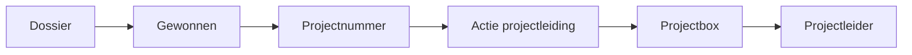

# Handleiding TILO

TILO is het verkoopprogramma van Thielemans. Hieronder staat hoe je het nu gebruikt.

## 1. Aanmelden

Open TILO. Op het scherm **Aanmelden** vul je je e-mailadres en je wachtwoord in, en kies je **Aanmelden**. Elke persoon meldt zich aan met het eigen e-mailadres.

- Een verkoper komt op **Verkoop**, met alleen de eigen cijfers.
- Een projectleider komt op **Projectleiding**.
- Een beheerder ziet in het menu **Verkoop** en **Projectleiding**, en komt op **Verkoop** met de cijfers van alle verkopers.

## 2. Verkopers en projectleiders

Een verkoper ziet het eigen dashboard en de eigen offertedossiers. Een nieuw dossier krijgt die verkoper automatisch. De verkoper kan het dossier niet aan iemand anders zetten.

| Verkoper | E-mail |
| --- | --- |
| Ideler Yannick | yannick.ideler@thielemans.be |
| Van Doorslaer Merel | merel.vandoorslaer@thielemans.be |
| Van Doorslaer Kristof | kristof.vandoorslaer@thielemans.be |
| Haegeman Robbe | robbe.haegeman@thielemans.be |
| Saerens Evi | evi.saerens@thielemans.be |
| Annaert Uwee | uwee.annaert@thielemans.be |
| De Meersman Stijn | stijn.demeersman@thielemans.be |

Projectleiders zijn geen verkopers. Hun naam staat niet in de verkoperfilter en komt niet als verkoper op een nieuw dossier. Zij werken in **Projectleiding**.

| Projectleider | E-mail |
| --- | --- |
| Van Holder Jens | jens.vanholder@thielemans.be |
| Van Aerschot Johan | johan.vanaerschot@thielemans.be |
| De Boeck Jelle | jelle.deboeck@thielemans.be |
| Van Loo Anne | anne.vanloo@thielemans.be |
| Migeotte Aaron | aaron.migeotte@thielemans.be |

Het adres is voornaam en achternaam aan elkaar, in kleine letters, gevolgd door `@thielemans.be`.

## 3. Verkoop

In het menu **Verkoop** staan Dashboard, Klanten, Offertedossiers, Offertes, Offertebox en RaamStudio.

### Dashboard

Bovenaan kies je de periode: **Vandaag**, **Deze week**, **Deze maand**, **Vorige maand**, **Dit kwartaal**, **Dit jaar**, **Vorig jaar** of **Aangepaste periode**. Bij een aangepaste periode vul je **Van** en **Tot** in en kies je **Toon**. Zonder keuze geldt **Deze maand**.

De bedragen zijn het opgeslagen totaal bruto (incl. btw). Er zijn geen quota en geen doelen.

Een verkoper ziet alleen de eigen cijfers. Een beheerder ziet alle cijfers en filtert met **Verkoper**: alle verkopers, één verkoper uit de lijst hierboven, of **Geen verkoper**. Projectleiders staan niet in die filter.

### Offertedossiers

Een offertedossier hoort bij een klant. Via **+ Nieuwe aanvraag** maak je een dossier. Bij een verkoper staat de eigen naam al als verkoper. Een beheerder kiest de verkoper.

Op het dossier loopt de statusbalk: Nieuw, In behandeling, Offerte verstuurd, Opvolging, en daarna Gewonnen of Verloren. Bij Gewonnen komt de stap **Project maken** erbij.

Een verkoper ziet alleen de eigen dossiers.

### Offertes

Onder **Offertes** staan de offertes van de offertedossiers, met totaal bruto, of de offerte verstuurd is, en of ze gewonnen is. Zonder opgeslagen totaal bruto staat er geen bedrag.

### Offertebox

**Offertebox** heeft twee kolommen:

- **Te verdelen**: de aanvraag heeft nog geen verkoper. Kies een verkoper bij **Verdelen**.
- **Wachten op offerte**: de verkoper is gekozen. De aanvraag blijft hier tot de offerte verstuurd is.

### RaamStudio

**RaamStudio** opent vanuit het gekozen offertedossier: in het menu, of via het RaamStudio-bestand op het dossier. De stappen zijn Tekeningen, Grondplan, Gevels, Maten en Raaminfo. Op de laatste stap, **Raaminfo**, maakt **PDF-voorbeeld** een PDF van de genummerde grondplannen en daarna de genummerde gevels.

### Gewonnen, projectnummer en Actie projectleiding

Op één dossier kunnen meerdere offertes tegelijk gewonnen zijn. Zet een verstuurde offerte op gewonnen met **Op gewonnen zetten**, of kies **Gewonnen** en duid de offerte aan. Dat kan alleen als er een totaal bruto is opgeslagen. De balk bovenaan het dossier telt die opgeslagen totalen bij elkaar.

Op een gewonnen dossier zonder projectnummer staat **Project maken**. Die knop maakt een projectnummer van 10 cijfers. Het eerste cijfer is altijd 1. De laatste twee cijfers zijn het jaar, dit jaar 26. Het eerste nummer is 1000000126. Het volgende verhoogt de middelste cijfers: 1000000226, enzovoort. Een nieuw jaar krijgt de twee cijfers van dat jaar. Het nummer blijft zichtbaar op het offertedossier en op het project. Daarna opent **Naar project** het project.

Op het offertedossier staat het vakje **Actie projectleiding**.

## 4. Projectleiding

In het menu **Projectleiding** staan Dashboard, Projectbox en Projecten.

### Dashboard

Elke kaart toont het projectnummer, het nummer van het offertedossier (**Project-Nr**), de status, de verkoper en de klant. De offertes die al op het project staan, staan erbij, met het totaal bruto als dat al is ingevuld. Daarnaast staat het aantal dossiers in **Projectbox**, per projectleider, en **Niet toegewezen**.

### Projecten

De lijst toont Projectnummer, Project-Nr, Projectbeschrijving, Klant en Verkoper. Open een rij voor het projectscherm.

### Projectscherm

De kop toont het projectnummer, het offertedossier, de klant en de verkoper. Zodra een projectleider is toegewezen, staat die naam er als **Projectleider**.

De tabbladen staan in deze volgorde:

1. Algemeen
2. Planning
3. Facturatie
4. Doc. & bestell.
5. Bestanden
6. DNV
7. Afwijkingen
8. Comm. & mail
9. Contact & fact. params
10. Sub-projecten
11. Taken
12. Projectinhoud

Op Planning vul je Aantal werkdagen chassis en Aantal werkdagen glas in als een geheel getal; leeg mag.

Een veld zonder gegevens blijft leeg, met een streepje, tot iemand het invult. **Projectinhoud** toont de offertes die al op het dossier staan. **Bestanden** toont de documenten die er al zijn.

### Projectbox

Een dossier staat in **Projectbox** als **Actie projectleiding** aan staat en het dossier al een projectnummer van 10 cijfers heeft.

Kies in de kolom **Projectleider** één van de vijf projectleiders. Die naam wordt opgeslagen en staat op het project als **Projectleider**.

## 5. Stroomschema

Een gewonnen dossier krijgt een projectnummer; met Actie projectleiding komt het in Projectbox, waar je een projectleider kiest.
